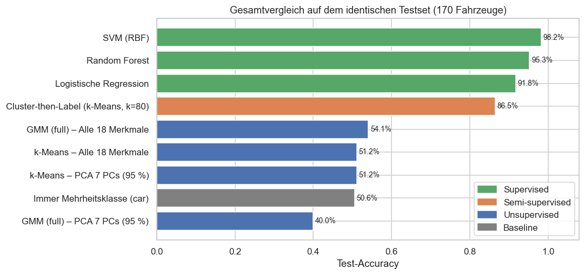

# Cars Silhouette – Fahrzeugklassifikation mit Unsupervised Learning

🇬🇧 [English version](README.md) · 🇩🇪 Deutsch

Die Werkstattkette **Prospect Auto** benötigt ein Modell, das **Bus, Van und Pkw** anhand geometrischer Silhouetten-Merkmale unterscheidet.
Das Problem wurde zuvor überwacht gelöst. In diesem Projekt untersuchen wir, wie weit man **ohne Labels** (Clustering) kommt und ob eine **PCA-Dimensionsreduktion** hilft.



## Kernergebnisse

| Ansatz | Modell | Test-Accuracy | ARI | benötigte Labels |
|---|---|---:|---:|---:|
| Supervised | **SVM (RBF), alle 18 Merkmale** | **98.2 %** | 0.95 | 676 |
| Supervised | Random Forest | 95.3 % | 0.86 | 676 |
| Supervised | Logistische Regression | 91.8 % | 0.76 | 676 |
| Semi-supervised | Cluster-then-Label (k-Means, k = 80) | 86.5 % | – | 80 |
| Unsupervised | GMM (full), k = 3, alle 18 Merkmale | 54.1 % | 0.11 | 0 |
| Unsupervised | k-Means, k = 3 | 51.2 % | 0.09 | 0 |
| Baseline | immer Mehrheitsklasse (Pkw) | 50.6 % | 0.00 | 0 |

*Testset: 170 Fahrzeuge (stratifizierter 80/20-Split). Bei Clustering-Modellen wird die Zuordnung Cluster → Klasse per Hungarian Matching ausschließlich auf dem Trainingsset gelernt.*

1. **PCA ist technisch erfolgreich, fachlich aber nicht effektiv.** 18 → 7 Komponenten erklären 96 % der Varianz, weil die Merkmale stark multikollinear sind (17 Paare mit |r| > 0.9).
   Die SVM fällt mit 7 PCs aber von 98.2 % auf 92.8 % CV-Accuracy, der GMM-ARI von 0.20 auf 0.08. Die klassenrelevante Information steckt teils in varianzarmen Richtungen.
2. **Clustering findet die falsche Struktur.** Die stärkste natürliche Struktur (Silhouette-Maximum bei k = 2, BIC-Minimum bei k = 7) bildet Geometrie und Perspektive der Silhouette ab, nicht den Fahrzeugtyp.
   Interne Metriken (Silhouette) und externe Metriken (ARI) widersprechen sich systematisch.
3. **Supervised Learning ist klar überlegen:** über 40 Prozentpunkte mehr Accuracy als das beste Clustering.
4. **Clustering ist als Label-sparende Vorstufe nützlich.** Mit nur 20 gelabelten Cluster-Repräsentanten (3 % der Labels) erreicht man ≈ 78 %, mit 80 Labels ≈ 87 %.

**Empfehlung:** SVM (RBF) auf allen 18 Yeo-Johnson-transformierten Merkmalen, ohne PCA, als Produktivmodell.
Clustering ist kein Klassifikator. Es eignet sich zum Label-Sparen bei neuen Fahrzeugtypen und zur Drift-/Anomalie-Erkennung.

## Projektstruktur

```
Unsupervised Cars Silhouette/
├── data/
│   └── vehicle.csv                          # Rohdaten: 846 Fahrzeuge × 18 Merkmale + Klasse
├── notebooks/
│   └── Unsupervised_Cars_Silhouette.ipynb   # vollständige Analyse (ausgeführt, mit Outputs)
├── src/
│   ├── train.py                             # finales SVM-Modell trainieren, evaluieren, speichern
│   └── predict.py                           # neue Fahrzeuge aus einer CSV klassifizieren
├── models/
│   └── svm_pipeline.joblib                  # trainierte Pipeline (Imputer → PowerTransformer → SVM)
├── reports/
│   ├── Unsupervised_Cars_Silhouette.html    # Notebook als HTML-Report (ohne Jupyter lesbar)
│   └── figures/                             # alle Abbildungen als PNG
├── requirements.txt
├── LICENSE                                  # MIT
├── README.md                                # englische Version
└── README.de.md
```

## Methodik

| Schritt | Umsetzung |
|---|---|
| Datenqualität | 0 Duplikate, < 1 % fehlende Werte pro Spalte → Median-Imputation |
| Split | stratifiziert 80/20 **vor** allen Transformationen (kein Data Leakage) |
| Normalisieren + Standardisieren | Yeo-Johnson-`PowerTransformer` (mittlere \|Schiefe\| 1.08 → 0.05, danach z-standardisiert) |
| Dimensionsreduktion | PCA: Scree-Plot, 90/95/99 %-Schwellen, Kaiser-Kriterium, Loadings, Rekonstruktionsfehler, Downstream-Effekt |
| Wahl von k | Elbow, Silhouette, Calinski-Harabasz, Davies-Bouldin, GMM-BIC/AIC, Ward-Dendrogramm |
| Clustering | k-Means, Gaussian Mixture (full), Agglomerativ (Ward), Spectral, jeweils auf 18 Merkmalen, 7 PCs und 2 PCs |
| Evaluation | intern: Silhouette, DB · extern: ARI, NMI, Homogenität/Vollständigkeit/V-Measure · Accuracy/F1 nach Hungarian Matching · Bootstrap-Stabilität |
| Semi-supervised | Cluster-then-Label mit Label-Budget von 3 bis 80, verglichen mit zufällig gelabelten Stichproben |
| Supervised-Baseline | Logistische Regression, Random Forest, SVM: 5-fache stratifizierte CV + Testset |

## Ausführen

```bash
pip install -r requirements.txt
cd notebooks
jupyter notebook Unsupervised_Cars_Silhouette.ipynb
```

Das Notebook liest die Daten relativ aus `../data/vehicle.csv`. Alle Zufallsprozesse verwenden `RANDOM_STATE = 42`, die Ergebnisse sind reproduzierbar.

### Modell trainieren & neue Fahrzeuge klassifizieren

```bash
python src/train.py                                   # CV + Test-Evaluation, danach Fit auf allen Daten → models/
python src/predict.py neue_fahrzeuge.csv -o predictions.csv
```

`predict.py` erwartet die 18 Merkmalsspalten aus `data/vehicle.csv`. Fehlende Werte werden imputiert.
Die Ausgabe enthält pro Fahrzeug `predicted_class` und `confidence` (Wahrscheinlichkeit der vorhergesagten Klasse).

## Lizenz

[MIT](LICENSE)

---

## Ursprüngliche Aufgabenstellung

**Daten:** Silhouetten-Features von drei Fahrzeugtypen aus verschiedenen Blickwinkeln: Doppeldeckerbus, Chevrolet-Van und Pkw (Saab 9000 oder Opel Manta). Alle Features sind geometrische Eigenschaften der Silhouette und daher numerisch.

**Aufgaben:**
1. Benötigte Bibliotheken importieren und den Datensatz einlesen. Eine erneute EDA ist nicht nötig.
2. Daten vorbereiten: Spalten normalisieren und standardisieren, danach in Trainings- und Test-Set aufteilen.
3. Prüfen, ob sich die 18 Merkmale per PCA auf weniger Dimensionen mit gleicher Varianz abbilden lassen, und ein Fazit zur Effektivität ziehen.
4. Die Klassifikationsaufgabe mit einem unüberwachten Clustering-Verfahren lösen und mit passenden Metriken bewerten.
5. Vergleichen, ob für dieses Problem Unsupervised oder Supervised Learning besser geeignet ist.
