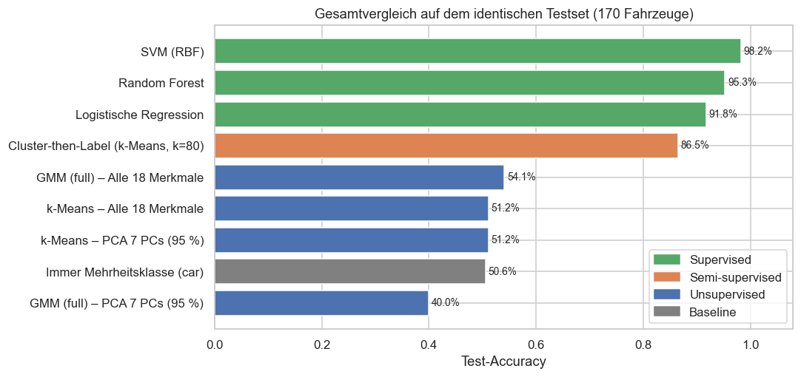

# Cars Silhouette – Vehicle Classification with Unsupervised Learning

🇬🇧 English · 🇩🇪 [Deutsche Version](README.de.md)

The auto-repair chain **Prospect Auto** needs a model that tells a **bus, van and car** apart from geometric features of their silhouettes.
The problem had been solved with supervised learning before. This project asks how far we can get **without labels** (clustering) and whether **PCA dimensionality reduction** helps.



## Key Results

| Approach | Model | Test accuracy | ARI | Labels needed |
|---|---|---:|---:|---:|
| Supervised | **SVM (RBF), all 18 features** | **98.2 %** | 0.95 | 676 |
| Supervised | Random Forest | 95.3 % | 0.86 | 676 |
| Supervised | Logistic Regression | 91.8 % | 0.76 | 676 |
| Semi-supervised | Cluster-then-Label (k-Means, k = 80) | 86.5 % | – | 80 |
| Unsupervised | Gaussian Mixture (full), k = 3, all 18 features | 54.1 % | 0.11 | 0 |
| Unsupervised | k-Means, k = 3 | 51.2 % | 0.09 | 0 |
| Baseline | always predict the majority class (car) | 50.6 % | 0.00 | 0 |

*Test set: 170 vehicles (stratified 80/20 split). For the clustering models, the cluster → class mapping is learned with Hungarian matching on the training set only.*

1. **PCA works technically but not for the task.** 7 components explain 96 % of the variance of the 18 features, because the features are highly collinear (17 pairs with |r| > 0.9).
   With 7 components, however, the SVM drops from 98.2 % to 92.8 % CV accuracy and the GMM's ARI from 0.20 to 0.08. Part of the class information sits in low-variance directions that PCA discards.
2. **Clustering finds the wrong structure.** The strongest natural structure in the data (silhouette score peaks at k = 2, BIC minimum at k = 7) reflects the geometry and viewing angle of the silhouette, not the vehicle type.
   Internal metrics (silhouette) and external metrics (ARI) consistently disagree.
3. **Supervised learning is clearly better:** more than 40 percentage points higher accuracy than the best clustering.
4. **Clustering is useful as a label-saving first step.** Labelling only 20 cluster representatives (3 % of the labels) reaches ≈ 78 %; 80 labels reach ≈ 87 %.

**Recommendation:** use the SVM (RBF) on all 18 Yeo-Johnson-transformed features, without PCA, as the production model.
Clustering is not a classifier here. It is useful for saving labelling effort when new vehicle types appear, and for drift/anomaly detection.

## Project Structure

```
Unsupervised Cars Silhouette/
├── data/
│   └── vehicle.csv                          # raw data: 846 vehicles × 18 features + class
├── notebooks/
│   └── Unsupervised_Cars_Silhouette.ipynb   # full analysis (executed, with outputs; German)
├── src/
│   ├── train.py                             # train, evaluate and save the final SVM model
│   └── predict.py                           # classify new vehicles from a CSV file
├── models/
│   └── svm_pipeline.joblib                  # trained pipeline (imputer → PowerTransformer → SVM)
├── reports/
│   ├── Unsupervised_Cars_Silhouette.html    # notebook as an HTML report (no Jupyter needed)
│   └── figures/                             # all figures as PNG
├── requirements.txt
├── LICENSE                                  # MIT
├── README.md
└── README.de.md                             # German version
```

## Method

| Step | Implementation |
|---|---|
| Data quality | 0 duplicates, < 1 % missing values per column → median imputation |
| Split | stratified 80/20 **before** any transformation (no data leakage) |
| Normalise + standardise | Yeo-Johnson `PowerTransformer` (mean \|skewness\| 1.08 → 0.05, then z-standardised) |
| Dimensionality reduction | PCA: scree plot, 90/95/99 % thresholds, Kaiser criterion, loadings, reconstruction error, effect on downstream models |
| Choosing k | elbow, silhouette, Calinski-Harabasz, Davies-Bouldin, GMM BIC/AIC, Ward dendrogram |
| Clustering | k-Means, Gaussian Mixture (full), agglomerative (Ward), spectral; each on 18 features, 7 PCs and 2 PCs |
| Evaluation | internal: silhouette, DB · external: ARI, NMI, homogeneity/completeness/V-measure · accuracy/F1 after Hungarian matching · bootstrap stability |
| Semi-supervised | Cluster-then-Label with label budgets from 3 to 80, compared with randomly labelled samples |
| Supervised baseline | logistic regression, random forest, SVM: stratified 5-fold CV + test set |

## Getting Started

```bash
pip install -r requirements.txt
cd notebooks
jupyter notebook Unsupervised_Cars_Silhouette.ipynb
```

The notebook reads the data from `../data/vehicle.csv`. All random processes use `RANDOM_STATE = 42`, so results are reproducible.

### Train the model and classify new vehicles

```bash
python src/train.py                                   # CV + test evaluation, then refit on all data → models/
python src/predict.py new_vehicles.csv -o predictions.csv
```

`predict.py` expects the 18 feature columns of `data/vehicle.csv`; missing values are imputed.
For each vehicle the output contains `predicted_class` and `confidence` (probability of the predicted class).

## Data

Silhouette features of three vehicle types photographed from different angles: a double-decker bus, a Chevrolet van, and a car (Saab 9000 or Opel Manta).
All features are geometric properties of the silhouette and therefore numeric.

## License

[MIT](LICENSE)
